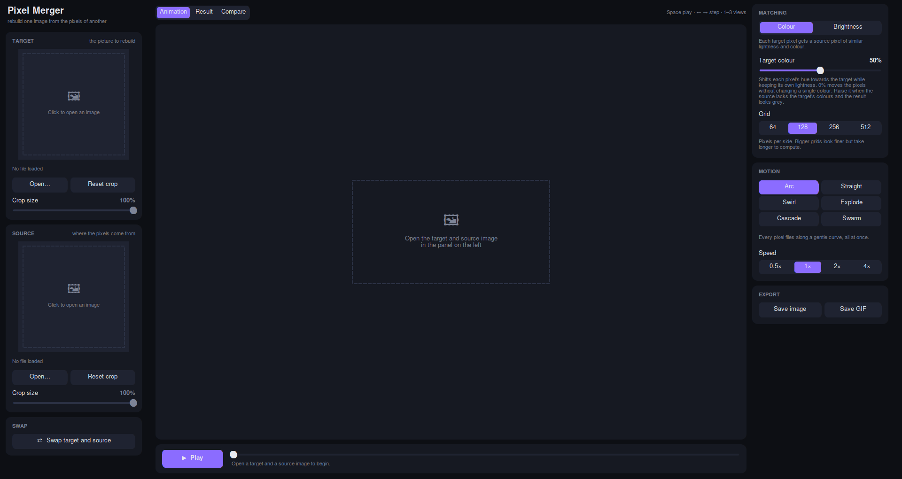
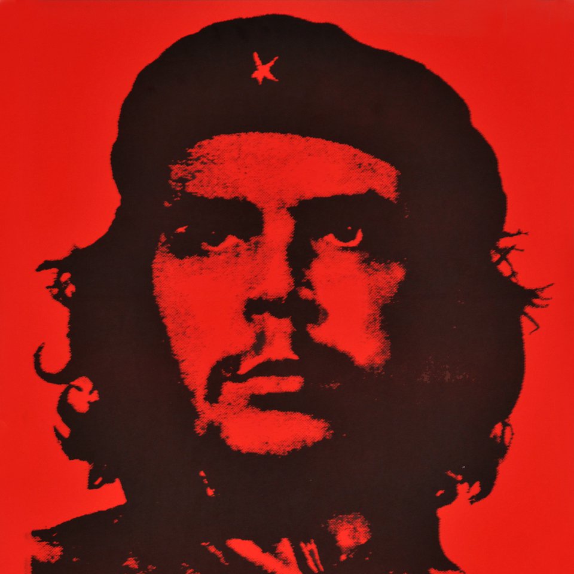
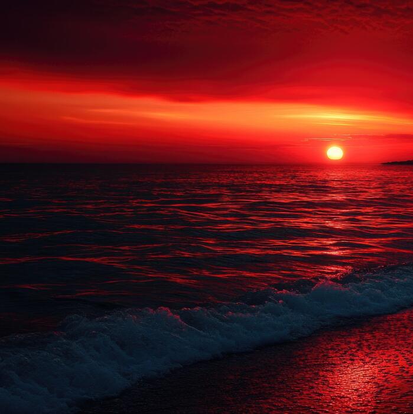
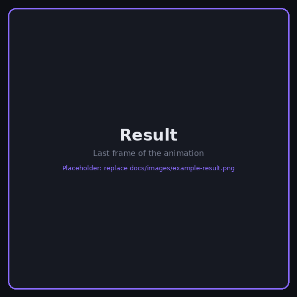
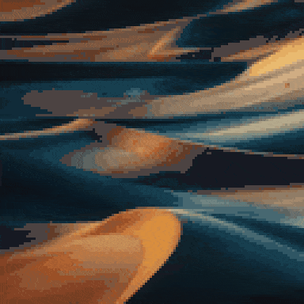
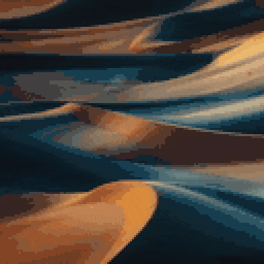
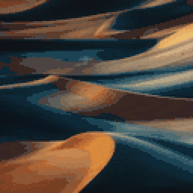

<div align="center">

# Pixel Merger

**Rebuild one image out of the pixels of another, then watch every pixel fly to its new place.**




</div>

Pixel Merger takes a **source** image and rearranges its pixels so that, together, they resemble a **target**
image. No pixel is added or removed: every pixel of the source is simply moved, and, if you want, nudged
towards the target's colour. The app then animates the whole rearrangement in one of six motion styles and
lets you export the animation as a GIF.

| Target | Source | Result |
|:---:|:---:|:---:|
|  |  |  |

## Demo

| Arc | Cascade | Explode |
|:---:|:---:|:---:|
|  |  |  |

## Contents

- [Features](#features)
- [Installation](#installation)
- [Quick start](#quick-start)
- [How it works](#how-it-works)
- [Settings](#settings)
- [Troubleshooting](#troubleshooting)
- [More projects](#more-projects)
- [License](#license)

## Features

- **Any two images:** PNG, JPEG, BMP, GIF, WebP or TIFF, at any resolution.
- **Square crop for each image:** click or drag to move it; the slider or the mouse wheel resizes it.
- **Colour-aware matching:** pixels are paired by lightness *and* colour, so colours land where they belong.
- **Target colour blend:** shifts each pixel's hue towards the target when the source lacks its colours.
- **Six motion styles:** Arc, Straight, Swirl, Explode, Cascade and Swarm.
- **Grid size of 64, 128, 256, 512 or 1024:** choose between a quick, blocky mosaic and a detailed one.
- **Playback controls:** play, pause, a timeline to scrub through, arrow keys to step, and 0.5×–4× speed.
- **Three views:** the animation, the result, and the target and result side by side.
- **Export** the result as PNG or JPEG and the animation as a GIF.

## Installation

You need **Python 3.10 or newer** (developed and tested with 3.12).

### Windows

1. Install Python from [python.org](https://www.python.org/downloads/). In the installer, tick
   **Add python.exe to PATH**. Tkinter is included.
2. Download this project: **Code → Download ZIP** on GitHub, then unzip it. If you use Git, run
   `git clone https://github.com/omroz14/Pixel-Merger.git` instead.
3. Open PowerShell in the project folder and run:

   ```powershell
   py -m venv .venv
   .venv\Scripts\Activate.ps1
   pip install -r requirements.txt
   py main.py
   ```

   If PowerShell refuses to run `Activate.ps1`, run
   `Set-ExecutionPolicy -Scope CurrentUser RemoteSigned` once, then try again.

### Linux (Debian, Ubuntu, Linux Mint)

Tkinter is a system package, so `pip` cannot install it.

```bash
sudo apt install python3-tk python3-venv git
git clone https://github.com/omroz14/Pixel-Merger.git
cd Pixel-Merger
python3 -m venv .venv
source .venv/bin/activate
pip install -r requirements.txt
python main.py
```

### macOS

Install Python from [python.org](https://www.python.org/downloads/) (it includes Tkinter), then:

```bash
git clone https://github.com/omroz14/Pixel-Merger.git
cd Pixel-Merger
python3 -m venv .venv
source .venv/bin/activate
pip install -r requirements.txt
python main.py
```

### Running it again later

Open a terminal in the project folder, activate the environment (`.venv\Scripts\Activate.ps1` on Windows,
`source .venv/bin/activate` elsewhere) and run `python main.py`.

## Quick start

1. Under **Target**, click **Open…** (or the empty preview) and pick the picture you want to recreate.
2. Under **Source**, click **Open…** and pick the picture whose pixels will be used.
   **⇄ Swap target and source** exchanges the two.
3. Adjust each crop: click or drag on the preview to move the square, and use **Crop size** or the mouse
   wheel to resize it. **Reset crop** centres the largest possible square.
4. In **Matching**, choose **Colour** or **Brightness**, a **Target colour** amount and a **Grid** size.
5. In **Motion**, pick how the pixels travel and the playback speed.
6. Press **▶ Play** (or Space). Drag the timeline, or use ← and →, to look at any moment.
7. Under **Export**, click **Save image** or **Save GIF**.

Keyboard: **Space** play / pause · **← →** step one frame · **1–3** switch views.

**Tip:** a pure rearrangement can only use the colours the source already has. If the target is red and green
but the source is brown and grey, the result shows the target's shapes in brown and grey and looks almost
black and white. Raise **Target colour** to bring the target's hues back.

## How it works

1. Both crops are resized to an N × N grid, where N is the chosen grid size.
2. **Matching** pairs every source pixel with one target cell:
   - **Colour:** both sets of pixels are converted to [OKLab](https://bottosson.github.io/posts/oklab/), a colour
     space where distances follow how different colours look. Both sets are split in half along the axis
     (lightness, green–red or blue–yellow) where they vary most, and each half is split again until single
     pixels remain. Equal halves on both sides make the result a one-to-one pairing of similar colours.
   - **Brightness:** both sets are sorted by luminance, `0.299·R + 0.587·G + 0.114·B`, and the *k*-th darkest
     source pixel goes to the *k*-th darkest target cell.
3. **Target colour** moves each pixel's OKLab hue and saturation towards the cell it lands on, keeping its own
   lightness. During the animation the colour shifts gradually as the pixel flies.
4. Each **motion** style is a formula for a pixel's position at time *t*, with smoothstep easing `3t² − 2t³`:
   Arc bends the straight path with a sine bulge, Swirl rotates it around the centre, Explode pushes pixels
   outwards first, and Cascade and Swarm give every pixel its own start delay (by row, or at random).
5. Frames are computed with NumPy the first time they are shown, then kept for replay and the GIF.

The pairing is recomputed only when an image, a crop, the grid size or the matching mode changes.

### Project structure

| File | Contents |
|------|----------|
| `main.py` | Entry point: checks that Tkinter and CustomTkinter are installed and opens the window. |
| `ui.py` | The window: image panels and crops, settings, the stage, playback and export. |
| `merger.py` | Pixel matching, colour conversion and the motion paths. No GUI code. |
| `theme.py` | Colours, fonts and small shared widgets. |
| `requirements.txt` | Python dependencies (`numpy`, `Pillow`, `customtkinter`). |

## Settings

These constants can be changed to taste:

| Constant | File | Default | Meaning |
|----------|------|---------|---------|
| `FRAMES` | `ui.py` | `100` | Number of animation frames |
| `BASE_FRAME_MS` | `ui.py` | `40` | Delay between frames at 1× speed (40 ms = 25 fps) |
| `EXPORT_MIN_PX` | `ui.py` | `512` | Minimum size of exported images and GIFs (the grid is scaled up by a whole number) |
| `CHROMA_WEIGHT` | `merger.py` | `2.0` | How much colour counts against lightness in Colour matching |
| `ARC_STRENGTH` | `merger.py` | `0.15` | How far the Arc, Cascade and Swarm paths curve |
| `SWIRL_TURNS` | `merger.py` | `0.75` | Extra rotation in Swirl, in full turns |
| `EXPLODE_PUSH` | `merger.py` | `0.3` | How far Explode throws pixels out, as a fraction of the grid |
| `STAGGER` | `merger.py` | `0.6` | Share of the animation used for start delays in Cascade and Swarm |

## Troubleshooting

| Problem | Fix |
|---------|-----|
| `ModuleNotFoundError: No module named 'tkinter'` | Install Tkinter: `sudo apt install python3-tk` on Linux, or reinstall Python from python.org on Windows/macOS. |
| `ModuleNotFoundError: No module named 'numpy'`, `'PIL'` or `'customtkinter'` | Activate the virtual environment, then run `pip install -r requirements.txt`. |
| `py` or `python` is not recognised (Windows) | Reinstall Python and tick **Add python.exe to PATH**. |
| Computing takes a long time | The 512 grid moves over 260,000 pixels per frame and 1024 over a million (about 15 s to match, about 0.1 s per frame the first time it plays, and around 300 MB of memory for the frames). Use 128 or 256 for quicker results. |
| The result looks almost black and white | The source lacks the target's colours. Raise **Target colour**, or pick a more colourful source. |

## More projects

- [Pixel Sort Studio](https://github.com/omroz14/Pixel-sorter): sort the pixels of a photo along any direction.
- [Vector Field Studio](https://github.com/omroz14/VectorFieldVisualizer): explore 2D vector fields.

## License

Released under the [MIT License](LICENSE). © 2026 Oliwier Mróz.
